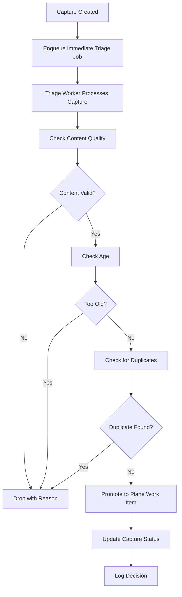

# Capture Triage System

## Overview

The capture triage system automatically processes new captures (bugs, ideas, feature requests) in near real-time to ensure they are reviewed and acted upon quickly. The system implements both event-driven processing (immediate) and periodic batch processing (safety net).

## Architecture

### Components

1. **Capture Creation Hook** - When a capture is created, an immediate triage job is enqueued
2. **Immediate Triage Handler** - Processes individual captures as soon as they're created
3. **Batch Scanner** - Runs every 30 minutes to catch any captures that weren't processed immediately
4. **Decision Logging** - Records all automated decisions for audit and rollback capability

### Processing Flow



## Implementation Details

### File Structure

```
src/
├── server/
│   ├── captures.js          # Capture creation and management
│   └── routes-widget.js     # Widget capture endpoint
├── worker/
│   ├── crons.js             # Periodic job scheduler
│   ├── index.js             # Worker job processor
│   └── handlers/
│       └── capture-triage.js # Main triage logic
```

### Real-time Processing

When a capture is created via any pathway (widget, dashboard, GlitchTip webhook):

1. `createCapture()` is called in `src/server/captures.js`
2. Immediately after DB insertion, `enqueueCaptureTriageJob()` is called
3. A job is enqueued to the `agents` queue with `agent: 'capture_triage'`
4. Worker picks up the job and calls `triageCapture()` for that specific capture

### Batch Processing

Every 30 minutes, a cron job runs:

1. Scheduled via `src/worker/crons.js` with pattern `*/30 * * * *`
2. Enqueues a job with `agent: 'capture_triage'` but no specific capture_id
3. Worker processes all captures with status `new` (up to 50 per run)

### Decision Criteria

1. **Content Quality**: Minimum 10 characters
2. **Age**: Maximum 72 hours old
3. **Duplicates**: Fuzzy search against existing Plane work items (80% similarity threshold)
4. **Promotion**: Creates Plane work item with appropriate metadata

### Outcomes

Each capture is processed to one of these outcomes:

- **Promoted**: Valid capture converted to Plane work item
- **Dropped**: Invalid, duplicate, or irrelevant capture
- **Deferred**: Processing issues - kept for manual review
- **Error**: System errors - kept for manual review

All decisions are logged to the `auto_decisions` table for audit and potential rollback.

## Configuration

The system uses these environment variables:

- `DEPLOY_TIMEZONE` - Timezone for cron scheduling (defaults to Europe/Paris)

## Monitoring

- Worker logs show processing statistics
- Failed captures remain in `new` status for manual review
- Auto-decision logs provide audit trail
- Telegram notifications for promotions and duplicates

## Testing

Unit tests are located in `src/worker/handlers/__tests__/capture-triage.test.js`

Run tests with:
```bash
npm test capture-triage
```